# koe-zukan

A multilingual animal onomatopoeia search site. A static site is generated from Excel master data and hosted on GitHub Pages.

- Site URL: https://koe-zukan.semnil.com
- Repository: https://github.com/semnil/koe-zukan (public)

## Directory structure

```mermaid
graph LR
  root["koe-zukan/"]
  root --> claudemd["CLAUDE.md<br>this file"]
  root --> github[".github/"]
  github --> funding["FUNDING.yml<br>GitHub Sponsors"]
  github --> ghtests["tests/"]
  ghtests --> wfcheckstestsh["workflow-checks-test.sh<br>test that runs workflow-checks.yml against a fake gh and fixture git trees"]
  ghtests --> automergetestsh["dependabot-auto-merge-test.sh<br>test that runs the deciding step of dependabot-auto-merge.yml against a fake gh"]
  ghtests --> deploytestsh["deploy-test.sh<br>test of the deploy.yml triggers, job conditions, build job permissions and concurrency group"]
  github --> workflows["workflows/"]
  workflows --> deployyml["deploy.yml<br>tests + build on every PR and push, GitHub Pages deploy on push to master (Python 3.12 + openpyxl + Pillow)"]
  workflows --> automergeyml["dependabot-auto-merge.yml<br>enables auto-merge on a Dependabot PR with a patch or minor update"]
  workflows --> wfchecksyml["workflow-checks.yml<br>checks on every PR that uses: is pinned to a SHA and follows the same-repository reference rules"]
  workflows --> wfcheckstestyml["workflow-checks-test.yml<br>runs the workflow tests under .github/tests/"]
  root --> data["data/"]
  data --> xlsx["animal-sounds-data.xlsx<br>master data (the single source of truth)"]
  data --> noaudio["no-audio.json<br>list of taxa with no Macaulay Library audio (generated by check_audio.py)"]
  root --> scripts["scripts/"]
  scripts --> buildpy["build.py<br>conversion script from Excel to dist/ (main)"]
  scripts --> addspecies["add_species.py<br>bulk species addition script"]
  scripts --> addkanji["add_kanji_names.py<br>bulk kanji name addition script"]
  scripts --> addkozh["add_ko_zh_onomatopoeia.py<br>bulk Korean / Chinese onomatopoeia addition"]
  scripts --> fetchtaxon["fetch_taxon_codes.py<br>ML taxonCode fetch script"]
  scripts --> checkaudio["check_audio.py<br>generates no-audio.json from an ML audio availability check"]
  root --> assets["assets/"]
  assets --> faviconsrc["favicon.svg<br>cat silhouette (purple gradient, left-right symmetric)"]
  root --> templates["templates/"]
  templates --> indextpl["index.html<br>main page template (placeholders: {{SITE_URL}}, {{SPECIES_COUNT}}, etc.)"]
  templates --> speciestpl["species.html<br>per-species page template (for SEO, JSON-LD structured data)"]
  root --> tests["tests/"]
  tests --> testbuild["test_build.py<br>build.py unit tests (pytest)"]
  tests --> testfrontend["test_frontend.mjs<br>frontend logic tests (node --test)"]
  root --> docs["docs/"]
  docs --> verification["verification-report.md<br>software verification report (V### findings + audit round entries)"]
  docs --> uxaudit["ux-audit-report.md<br>UI/UX audit report (WCAG 2.1 AA / 2.2 AA conformance check)"]
  docs --> qualityaudit["quality-audit-report.md<br>quality audit report (contract / syntax / pixel checks)"]
  root --> dist["dist/<br>build output (GitHub Pages deploy target, gitignored)"]
  dist --> distindex["index.html<br>generated from the template (placeholders replaced)"]
  dist --> animalsjson["animals.json"]
  dist --> regionsjson["regions.json"]
  dist --> sitemap["sitemap.xml<br>sitemap for Google (top page only)"]
  dist --> ogp["ogp.png<br>top page OGP image (1200x630, generated with Pillow)"]
  dist --> icon192["icon-192.png<br>PWA icon 192x192 (generated with Pillow, maskable)"]
  dist --> icon512["icon-512.png<br>PWA icon 512x512 (generated with Pillow, maskable)"]
  dist --> manifest["manifest.json<br>PWA manifest"]
  dist --> swjs["sw.js<br>Service Worker (cache-first)"]
  dist --> distfavicon["favicon.svg"]
  dist --> cname["CNAME<br>GitHub Pages custom domain"]
  dist --> speciesdir["species/{ID}/<br>per-species pages (one directory per species)"]
  speciesdir --> speciesindex["index.html<br>species page HTML (JSON-LD, OGP, share buttons, hreflang)"]
  speciesdir --> speciesogp["ogp.png<br>per-species OGP image (onomatopoeia in 4 languages)"]
```



## Build

```bash
pip3 install --user --break-system-packages openpyxl Pillow
python3 scripts/build.py
```

Reads `data/animal-sounds-data.xlsx` and writes the static site to `dist/`.

CJK fonts for the OGP images: `_find_cjk_fonts()` (scripts/build.py) resolves font paths only for Windows and Linux (Noto Sans CJK). On macOS no path matches and Pillow's default font (no CJK coverage) is used, so OGP images built locally on macOS are missing CJK glyphs. The `.github/workflows/deploy.yml` CI step installs `fonts-noto-cjk`, so the deployed OGP images render with CJK glyphs.

### Build output

- `animals.json`, `regions.json` — JSON data converted from Excel
- `index.html` — generated from the template by replacing the placeholders
- `species/{ID}/index.html` — per-species page (JSON-LD + OGP + share buttons + 5 hreflang links)
- `species/{ID}/ogp.png` — per-species OGP image (onomatopoeia in 4 languages, a font per CJK language)
- `sitemap.xml` — top page only (species pages are excluded for indexing efficiency)
- `ogp.png` — top page OGP image (generated with Pillow, reflects the species and language counts)
- `icon-192.png` / `icon-512.png` — PNG icons for the PWA (generated with Pillow from `favicon.svg`, `purpose: "any maskable"`)
- `manifest.json` — PWA manifest (registers `lang`, `scope`, and SVG + 192/512 PNG in the `icons` array)
- `sw.js` — Service Worker (versioned cache, cache-first, navigate falls back to `/`)
- `CNAME` — generated automatically from `SITE_URL`

### Template placeholders

#### index.html

| Placeholder | Content |
|---|---|
| `{{SITE_URL}}` | Site URL (the `SITE_URL` constant in build.py) |
| `{{SPECIES_COUNT}}` | Number of species |
| `{{LANGUAGE_COUNT}}` | Number of languages |
| `{{ONOMATOPOEIA_COUNT}}` | Total number of onomatopoeia entries |

#### species.html

| Placeholder | Content |
|---|---|
| `{{SITE_URL}}` | Site URL |
| `{{ID}}` | Species ID |
| `{{NAME_JA}}`, `{{NAME_EN}}` | Japanese name, English name |
| `{{SCIENTIFIC_NAME}}` | Scientific name |
| `{{ALT_EN}}` | English alternative name (in parentheses, or empty) |
| `{{CLASS}}`, `{{ORDER}}`, `{{FAMILY}}` | Class, order, family |
| `{{CLASS_CSS}}`, `{{CLASS_ICON}}` | Per-class tag CSS class and emoji (colors / icons unified with the top page) |
| `{{VOICE_METHOD}}` | Vocalization method ("—" if none) |
| `{{CONSERVATION}}` | Conservation status (IUCN code + Japanese label) |
| `{{REGIONS}}` | Habitat regions (separated by the Japanese comma 、) |
| `{{NOTE}}` | Notes HTML (empty if none) |
| `{{DESCRIPTION}}` | meta description |
| `{{ONO_SECTION}}` | Onomatopoeia section HTML (a `lang` attribute on each `ono-cell-text`) |
| `{{LINKS}}` | External links HTML (with `aria-label`, `rel="noopener"` and a visual `↗` mark) |
| `{{SHARE_BUTTONS}}` | Share buttons HTML (X/Facebook/LINE/copy URL) |
| `{{RELATED_SPECIES}}` | Related species section HTML (4-level fallback family→order→class→phylum, at most 4 entries, ascending ID) |
| `{{JSON_HEADLINE}}`, `{{JSON_DESCRIPTION}}` | Strings for JSON-LD with `<`/`>`/`&` escaped to `\u003c` etc. |
| `{{SPECIES_DATA_JSON}}` | i18n payload for the species page (ja+en of name/class/order/family/voiceMethod/regions, conservation code, onomatopoeia in 4 languages, etc.). A JSON literal with `<`/`>`/`&` escaped to `\u003c` etc. for an inline `<script>` |
| `{{RELATED_DATA_JSON}}` | i18n payload for related species (ja/en names + ja/en/ko/zh onomatopoeia of each species). Likewise a `<script>`-safe JSON literal |

Unreplaced placeholders produce a warning at build time (`_apply_placeholders`). `SHARE_BUTTONS` is excluded from the warning and injected separately in a later step (`RELATED_SPECIES` is replaced normally, because its value is passed through `_build_related_html`).

## Deploy

GitHub Actions (`.github/workflows/deploy.yml`) runs its `build` job (tests, build and the Pages artifact upload) on every pull request, every push to master and every manual run, and its `deploy` job deploys on push to master and on a manual run (the `github-pages` environment accepts master only). CI runs `pip install` / `python -m pytest` / `python scripts/build.py` on setup-python 3.12 (separate from the `pip3` / `python3` of the local steps in the "Build" and "Tests" sections).
GitHub Pages → custom domain `koe-zukan.semnil.com` (Route 53 CNAME → `semnil.github.io`).

The `main` ruleset of master requires the status checks `action-pins` (`workflow-checks.yml`), `build` (`deploy.yml`) and `auto-merge` (`dependabot-auto-merge.yml`), and every one of them reports on every pull request. `dependabot-auto-merge.yml` enables auto-merge (merge commit) on a Dependabot pull request whose update is a semver patch or minor and which is a single verified Dependabot commit, and turns it off otherwise; the merge waits for the required checks. A merge made by auto-merge is attributed to GITHUB_TOKEN and starts no workflow on master, so `deploy.yml` does not deploy it; the next push to master or a manual run of `deploy.yml` does.

## Excel sheets (7 sheets)

The sheet names and column headers are the workbook's actual Japanese names.

| Sheet | Content | Primary key |
|---|---|---|
| メインデータ | Basic information per species (15 columns, column O = taxonCode) | ID |
| 名称マッピング | Japanese name, scientific name, English name, alternative names, kanji name | ID |
| 分類マッピング | Multilingual names for phylum / class / order / family | (分類レベル, 和名) |
| オノマトペマッピング | Onomatopoeia in 4 languages + situation | (ID, 言語コード) |
| 凡例・定義 | Definitions of IUCN categories, vocalization methods, etc. | — |
| 地域マスター | Normalized master of regions | 地域ID |
| 地域マッピング | Many-to-many mapping of animals × regions | (ID, 地域ID) |

### Main data columns (A–O)

ID, 和名, 門, 綱, 目, 科, 鳴き声の有無, オノマトペ（日本語）, 発声方法, 生息地域, 保全状況, 画像参照, 備考, 音声参照, taxonCode

In English: ID, Japanese name, phylum, class, order, family, has a voice, onomatopoeia (Japanese), vocalization method, habitat regions, conservation status, image reference, notes, audio reference, taxonCode.

### ID scheme

- A: initial samples
- B: birds
- M: mammals
- I: insects
- F: amphibians
- R: reptiles
- S: fish
- V: invertebrates

### Language codes

- `ja`: 日本語 (Japanese)
- `en`: English
- `ko`: 한국어 (Korean)
- `zh`: 中文 (Chinese)

## Site architecture

- Fully static site (no backend needed)
- Frontend search: Fuse.js (self-hosted at `assets/fuse.min.js`, copied to the site root at build)
- Hiragana search: automatic katakana→hiragana conversion supports hiragana input such as "ねこ" and "にゃー"
- Automatic browser language detection: the initial display language is chosen automatically from ja/en/ko/zh with `navigator.language` (the URL `?lang=` parameter takes precedence). **The fallback for unsupported locales is English** (so that non-CJK visitors such as French or German speakers do not see kanji they cannot read). index.html and species.html use the same detection logic
- Multilingual detail pages: `/species/{ID}/` also supports 4 languages. The DOM is rewritten by combining `SPECIES_DATA` (embedded by build.py: ja+en of name/class/order/family/voiceMethod/regions, onomatopoeia in 4 languages, etc.) with the `I18N` dictionary (labels + IUCN conservation status translations). The initial HTML stays in Japanese (for SEO / no-JS visitors), and JS overwrites it in the selected language
- Language tab position (unified on both pages): in the header on index.html (right side of `.header-inner`), and to the right of the `←` link in the top bar on species.html. Both use the same semi-transparent bordered style on the green gradient band, and `min-height: 44px` unifies the tap targets
- The display language carries over between index and species: `?lang=<xx>` is added to the links "View detail page" in the modal, "← Animal Sound Encyclopedia", "← Back to encyclopedia" and those inside "Related species" (not added for ja, to keep the canonical URL)
- Data: converted from Excel to JSON at build time, fetched on page load and searched in memory
- Responsive (including mobile)
- OGP / Twitter Card support (top page + per-species pages, a font per CJK language)
- Per-species pages: `/species/{ID}/` (JSON-LD structured data, canonical URL; hreflang ja/en/ko/zh/x-default point at the page's own `/species/{ID}/?lang=*`)
- Share buttons: X (Twitter), Facebook, LINE, copy URL (species pages only; each aria-label and the copy feedback follow the display language)
- PWA support: manifest.json + Service Worker (cache-first, maskable 192/512 PNG icons)
- URL parameter `?id=` links directly to a card, and `?q=` sets the initial search query (the contract of the SearchAction `urlTemplate` in the `WebSite` JSON-LD)
- Google Search Console integration (sitemap + ownership verification meta tag)
- Related species links: a "Related species" section on species pages (4-level fallback family→order→class→phylum, at most 4 entries) — strengthens internal links for SEO
- Onomatopoeia pronunciation playback (species pages): a `🔊` button (`.ono-play`, 44×44 tap target) in each onomatopoeia cell (`.ono-cell`). It calls the browser's built-in TTS through the Web Speech API (`speechSynthesis` + `SpeechSynthesisUtterance`), mapping `data-play-lang` (ja/en/ko/zh) to a BCP-47 tag (`ja-JP`/`en-US`/`ko-KR`/`zh-CN`) with `PLAY_LANG_MAP` before playing. `utter.rate = 0.9` makes it slightly slower. In environments without `speechSynthesis`, JS adds `html.no-tts` at startup and CSS hides the buttons. `speechSynthesis.cancel()` is called before repeated clicks and before a new utterance to prevent overlapping playback, and `cancel()` is also called on `beforeunload` so playback does not continue across page navigation. During playback the button gets the `.playing` class (accent background), removed on `onend`/`onerror`. `updatePlayLabels(code)` regenerates the aria-label for the display language (e.g. `日本語の発音を再生` / `Play Japanese pronunciation` / `일본어 발음 재생` / `播放日语发音`; 4×4 = 16 combinations of `PLAY_LABELS` × `LANG_NAMES_LOCALIZED`). The initial HTML outputs the aria-label with the Japanese language names (`LANG_LABELS_JA`: 英語/韓国語/中国語), so that it reads naturally in Japanese even without JS

### Content differentiation (card / modal / species page)

| Item | Card | Modal (preview) | Species page (detail) |
|---|---|---|---|
| Name | Japanese name or display language | Display language | Japanese name + English name + scientific name |
| Class/order/family tags | Class only (with icon) | Class only | Full class/order/family hierarchy |
| Onomatopoeia | Display language main only | Display language (no situation) | 4 languages + situation + pronunciation playback button |
| External links | None | None | Yes (Wikimedia Commons / Wikipedia / xeno-canto / ML) |
| Share buttons | None | None | Yes (X/Facebook/LINE/copy URL) |
| Conservation status | — | Code only | Code + label in the display language |
| Related species | None | None | Yes |
| Detail link | Yes (inside the modal) | Yes ("View detail page →") | — (this page) |

### Multilingual UI constants (index.html)

- `NO_VOICE_LABEL` — "Silent" in 4 languages
- `NO_ONO_LABEL` — "No data" in 4 languages
- `MODAL_LABELS` — labels inside the modal (ono / info / voiceMethod / conservation / regions) in 4 languages
- `MODAL_HINT` / `CLOSE_LABEL` — modal operation hints in 4 languages
- `DETAIL_LINK_LABEL` — the text "View detail page →" in the modal, in 4 languages
- `VOICE_METHOD_EN` — Japanese→English map of vocalization methods (mirror of the constant of the same name in `scripts/build.py`)
- `ALL_LABEL` — the filter "All" in 4 languages
- `SEARCH_LABELS` — every search box element (label / placeholder / hint / clear / filters / langTabs / noResults / loading / loadError) in 4 languages
- `getDisplayName(a)` — returns the name for `displayLang`
- `getClassLabel(ci, a)` — class label for `displayLang`
- `getVoiceMethod(vm)` — vocalization method for `displayLang`
- `getRegionName(r)` — region name for `displayLang`
- `updateFilterLabels()` / `updateSearchLabels()` — UI updates called from `applyDisplayLang`

### Multilingual UI constants (species.html)

The detail page is self-contained and switches between 4 languages. When `applyLang(code)` is called, it reapplies everything below.

- `I18N[code]` — each language holds:
  - `htmlLang`, `siteName`, `title(name, alt)` — `<html lang>`, the site name, the `<title>` builder
  - `skipLink`, `topBar`, `backLink` — navigation text
  - `onoSection`, `infoSection`, `linksSection`, `shareSection`, `related`, `note` — section headings
  - `voiceMethod`, `conservation`, `regions` — text of `.detail-label`
  - `langTabsLabel`, `siteNav`, `silentDash`, `noVoice` — other labels
  - `copyLabel`, `copyOk`, `copyFail` — the 3 states of the copy URL button
  - `shareX`, `shareFB`, `shareLINE` — share button aria-labels
  - `ariaCommons`, `ariaXC`, `ariaML`, `ariaWikiJA`, `ariaWikiEN` — external link aria-labels
  - `iucnLabel` — translation dictionary of the 9 IUCN conservation status codes (LC/NT/VU/EN/CR/DD/NE/EW/EX)
- `SPECIES_DATA` — species-specific data (from build.py, see the placeholders above). The source of values on `applyLang`
- `RELATED_DATA` — related species data. `.related-grid` is redrawn on `applyLang`
- DOM markers (added by build.py):
  - `data-i18n="<key>"` — text to rewrite (textContent replaced with `L[key]`)
  - `data-link-kind="commons|xc|ml|wiki-ja|wiki-en"` — external links whose aria-label is switched
  - `data-share-kind="x|fb|line|copy"` — share buttons whose aria-label is switched (`copy` rewrites the inner `.copy-label` span)
  - `data-play-lang="ja|en|ko|zh"` / `data-play-text="<onomatopoeia>"` — TTS input of the pronunciation playback button (`.ono-play`). `speakOnomatopoeia(btn)` reads them and passes them to `SpeechSynthesisUtterance`
- Helpers: `detectLang()` (`?lang=` → `navigator.language` → en fallback), `withLang(path, code)` (adds lang to a link; not added for ja, to keep the canonical URL), `renderLangTabs()` (generates the language tabs in the top bar), `speakOnomatopoeia(btn)` (plays onomatopoeia with the Web Speech API), `updatePlayLabels(code)` (makes the pronunciation buttons' aria-labels follow the display language)
- Pronunciation playback constants:
  - `TTS_SUPPORTED` — existence check of `speechSynthesis` + `SpeechSynthesisUtterance` (when `false`, `html.no-tts` is added and the buttons are hidden)
  - `PLAY_LANG_MAP` — `{ ja: "ja-JP", en: "en-US", ko: "ko-KR", zh: "zh-CN" }` (BCP-47)
  - `LANG_NAMES_LOCALIZED[uiCode][onoCode]` — onomatopoeia language names per UI language (4×4 = 16 combinations)
  - `PLAY_LABELS[uiCode](langName)` — aria-label builder (template functions for 4 languages)

### SEO settings

- canonical URL:
  - Top page: `<link rel="canonical" href="https://koe-zukan.semnil.com/">` — normalizes each `?lang=` / `?id=` / `?q=` variation to `/`
  - Species page: `<link rel="canonical" href=".../species/{ID}/">` — normalizes URLs with `?lang=`
- Structured data (JSON-LD):
  - Top page: `@type: WebSite` (name / alternateName / url / description / `inLanguage: [ja, en, ko, zh]` / `potentialAction: SearchAction`)
  - The SearchAction `urlTemplate` is `https://koe-zukan.semnil.com/?q={search_term_string}`; the index.html JS takes `?q=`, puts it in the search box and runs `onSearch()`
  - Species page: `@type: Article` (headline / description / url / publisher). Strings are escaped with `_json_for_script()` (`<`/`>`/`&` to `\u003c` etc.)
- Sitemap: `dist/sitemap.xml` has only the top page URL. Species pages can be discovered through internal links (modal → species page + related species) but are not in the sitemap
  - Reason: excluded because species pages produced a large number of "Crawled - currently not indexed" entries (the policy of commit `8f76bf3`)
- meta description / OGP / Twitter Card are set on both pages. og:locale is `ja_JP` in the initial HTML, and JS rewrites it to `ja_JP` / `en_US` / `ko_KR` / `zh_CN` for the selected language

### Accessibility

- Conforms to WCAG 2.1 AA and the additional WCAG 2.2 AA SC (every item judged Pass in UX audit round 3)
- `<main id="main">` landmark + `.skip-link` "Skip to content" (both the index and species templates)
- `<html lang>` is synced by JS to the display language on both pages (initial value `ja`)
- Local `lang` attributes: `lang="en"` on English names, `lang="la"` on scientific names, per-language (`ja`/`en`/`ko`/`zh`) on the onomatopoeia `ono-cell-text`; the "alt-name" element on species pages switches between `lang="ja"`/`lang="en"` with the display language
- hreflang: 5 links (ja/en/ko/zh/x-default) on the top page (`/?lang=*`) + every species page (`/species/{ID}/?lang=*`). On both pages, `x-default` points at the canonical URL (no parameters)
- Tap targets of 44x44 or more: `min-height: 44px` / a fixed 44x44 is set explicitly on `.filter-btn`, `.lang-tab`, `.modal-close`, `.search-clear`
- Focus indicator: `outline: 2px solid var(--accent)` applied globally to `:focus-visible`. The search box has a double indicator of border + 3px semi-transparent ring through `.search-input-wrap:focus-within` (SC 2.4.11 Focus Appearance)
- Modal: `role="dialog"` + `aria-modal="true"` + `aria-labelledby` + focus trap + focus restored to `_modalOpener`
- The number of search results is announced with `aria-live="polite" aria-atomic="true"` (in 4 languages)
- External links: `rel="noopener"` + `aria-label="... (新しいタブで開く)"` + a visual `↗` mark
- Forms: `<form role="search">` landmark + `<label class="sr-only">` + `aria-hidden="true"` on SVG icons
- IME support: `compositionstart`/`compositionend` block the search debounce

### Security

- HTML escaping: `esc()` on the JS side (V001 added `'` → `&#39;`), `html.escape()` on the Python side
- JSON-LD escaping: `_json_for_script()` (scripts/build.py) converts `<`/`>`/`&` to `\u003c` `\u003e` `\u0026`, preventing a `</script>` payload from escaping the script block (OWASP recommendation)
- Every external link has `rel="noopener"`
- URL construction is unified on `encodeURIComponent()` (JS side) / `urllib.parse.quote(..., safe="")` (Python side)
- Wikipedia links use the same encoding rule in both Python and JS (V011 fix)
- Master-data validation: `validate_data()` (scripts/build.py) stops the build before anything is written when a main-data ID does not fully match `ID_PATTERN` (`[A-Z][0-9]+`), a non-empty `imageRef` does not start with `IMAGE_REF_PREFIX` (`https://commons.wikimedia.org/`), or any extracted animal or region value contains `{{`

### PWA / Service Worker

- `manifest.json`: `lang: "ja"`, `scope: "/"`, `start_url: "/"`, `display: "standalone"`, `theme_color: "#047857"`, `favicon.svg` + 192/512 PNG in icons (`purpose: "any maskable"`)
- `sw.js`: the version name `koe-zukan-v{YYYY-MM-DD}-{species_count}` clears the cache on install. fetch is cache-first; on a miss it falls back to the network and lazily caches only `resp.ok && GET`
- When a navigate request misses while offline, it falls back to `caches.match("/")` (SPA-like behavior)
- PNG icons are not precached but cached lazily on fetch (Chrome fetches them automatically when it reads the manifest)

## Search fields

Fields and weights in the Fuse.js index:

| Field | weight | Description |
|---|---|---|
| nameJA | 3.0 | Japanese name (highest priority) |
| _hira | 3.0 | Japanese name in hiragana (automatic katakana→hiragana conversion) |
| nameEN | 2.0 | English name |
| scientificName | 1.5 | Scientific name |
| altJA | 1.0 | Alternative names (including the kanji name) |
| _altHira | 1.0 | Alternative names in hiragana |
| altEN | 1.0 | English alternative names |
| onomatopoeiaJA | 2.5 | Japanese onomatopoeia |
| _onoHira | 2.5 | Japanese onomatopoeia in hiragana |
| onomatopoeia.onomatopoeia | 2.5 | Onomatopoeia in all languages |
| _onoAllHira | 2.5 | Onomatopoeia in all languages, in hiragana |
| voiceMethod | 0.5 | Vocalization method |
| family, order | 0.5 | Taxonomy (family, order) |

`_hira` / `_altHira` / `_onoHira` / `_onoAllHira` are generated on page load with `kataToHira()`. "ねこ" finds "ネコ", and "にゃー" finds "ニャー".

## External link references

- Image reference: `https://commons.wikimedia.org/wiki/Category:{学名}` (`{学名}` = scientific name)
- Audio reference (birds): `https://xeno-canto.org/species/{Genus}-{species}`
- Audio reference (others): `https://search.macaulaylibrary.org/catalog?taxonCode={taxonCode}&mediaType=audio`
  - No link is generated for a taxonCode listed in `data/no-audio.json`

## Managing audio references

1. `scripts/fetch_taxon_codes.py` — fetches taxonCode from the ML taxonomy API and writes it to column O of the Excel file
2. `scripts/check_audio.py` — checks with the ML API whether each taxonCode has audio and writes `data/no-audio.json`
3. `scripts/build.py` — reads no-audio.json and leaves audioRef empty for species without audio

These are scripts run by hand (not run in CI). Their results are committed as JSON.

## Notes on editing data

- The master data is `data/animal-sounds-data.xlsx` only. Do not edit the JSON in `dist/` directly
- When adding a species, add it consistently to every related sheet (メインデータ, 名称マッピング, オノマトペマッピング, 地域マッピング)
- Keep IDs sequential within each category (do not fill gaps)
- After editing, rebuild with `python3 scripts/build.py`

## Tests

```bash
pip3 install --user --break-system-packages pytest pytest-cov

# Python tests (build.py)
python3 -m pytest tests/test_build.py -v

# JavaScript tests (frontend logic)
node --test tests/test_frontend.mjs

# Python tests + coverage
python3 -m pytest tests/test_build.py --cov=scripts --cov-report=term-missing
```

## Documents

- **Override of the global CLAUDE.md's 「ドキュメント」 language rule**: this file is written entirely in English, and `README.md` is maintained in English with its Japanese counterpart `README.ja.md` (same sections in the same order, cross-linked at the top). The verification and audit reports under `docs/` (`verification-report.md`, `ux-audit-report.md`, `quality-audit-report.md`) are written in English only, with no Japanese counterpart
